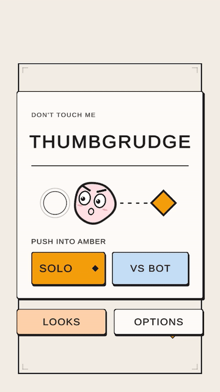
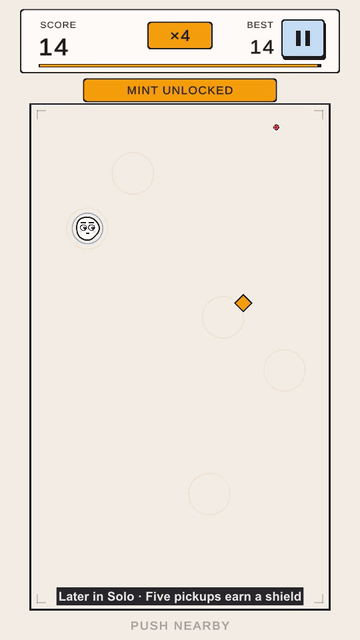
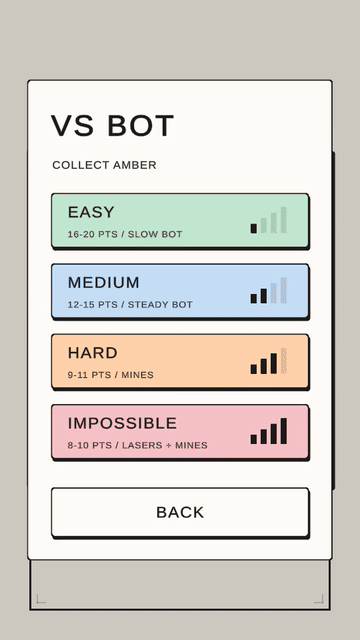
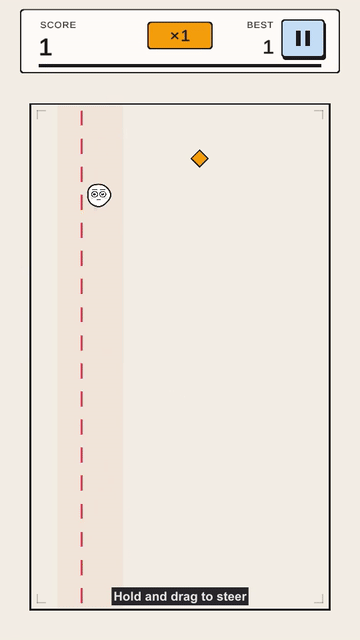
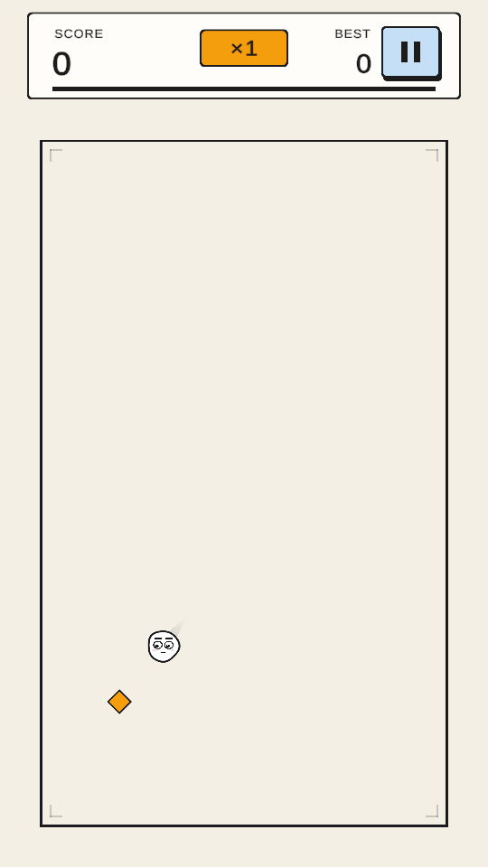
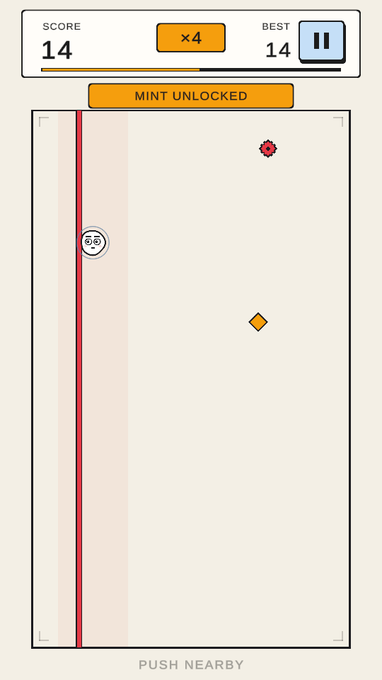
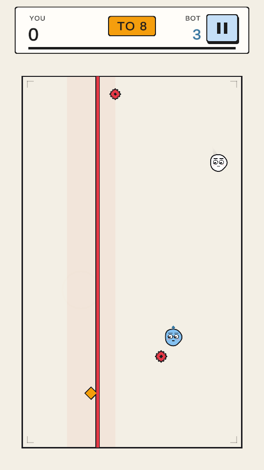
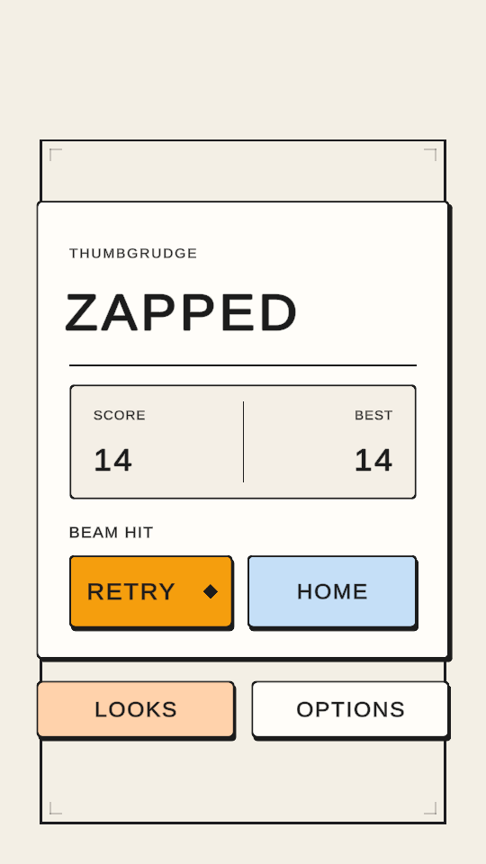

# Thumbgrudge

**Your blob has eyes. Your finger is the problem.**

**Theme: DON'T TOUCH · Team: Glitch & Glory**

    

**[Watch the full gameplay showcase](Docs/media/demo.mp4) · [Download the Android APK](Builds/Thumbgrudge.apk)**

## Judge quick start

Extract <strong>GlitchAndGlory-Thumbgrudge-Submission.zip</strong> to a regular folder first. Open this README in the extracted folder to find the APK, the media, and the Unity project together. From GitHub, the links below point to the same files.

| What you want to do | Open this |
|---|---|
| Play on an Android phone | `Builds/Thumbgrudge.apk`. From GitHub, open the [APK file](Builds/Thumbgrudge.apk) and choose **Download raw file**. |
| Watch without installing | [Docs/media/demo.mp4](Docs/media/demo.mp4). If GitHub shows a file page, choose **Download raw file**, then play the MP4. |
| Run or rebuild in Unity | Open the extracted `Source` folder from Unity Hub as the project. Use the exact Editor and scene in [Install or build](#install-or-build). On the first import, let Unity resolve the packages before pressing Play. |

On first launch, read **HOW TO PLAY** and tap **GOT IT**. You can reopen the animated guide from **OPTIONS** or the pause menu. Start with **SOLO**, tap just beside the blob, and bank it into an amber diamond. Then try **VS BOT → IMPOSSIBLE** for the shared-pickup race with both mines and lasers.
## Don't touch what you're trying to save

We made the touchscreen part of the rule. Put your thumb **beside** the blob and the repulsion field pushes it away. Hold and drag to steer, or push from outside the ink rails to line up a bank. Press **on** the blob in Solo and it shatters. Your thumb gives you control and can end the run in the same move. It takes one tap to feel the difference.

## The feature tour

| In motion | What to watch for |
|---|---|
|  | **Bank, collect, repeat.** Pick up amber diamonds within three seconds of each other to build a combo up to ×4. The amber bar drains as time runs out. Stay just outside touching distance (1.0–1.65 times the core radius) for a tightening dashed Nerve ring. Every 0.85 seconds earns +1 and refreshes the combo timer. |
|  | **Share the arena. Race for the same amber.** In **VS BOT**, both racers collect from the same pool for one point per node. They pass through each other, but a touch or hazard sends the affected racer to their starting spot with points intact. The first to hit that race's target wins. |
|  | **One tap back in.** A direct touch gives you **I SAID DON'T!** / **YOU TOUCHED IT**. Beams can leave you **ZAPPED** and mines **POKED**. The retry card shows the run score and saved **BEST**. The HUD tracks the best live, and Unity's local `PlayerPrefs` key `Thumbgrudge.Best` keeps it across app restarts. |

### The blob has opinions

- Touch the screen and its pupils track your finger. Let go and it glances toward nearby amber or hazards. Come close and it blushes, trembles, opens its mouth, and may bark **BACK OFF**, **PERSONAL SPACE**, **HEY!**, or **NOPE**.
- A hard push or wall bank briefly squashes and stretches the blob. Hit a wall hard enough and you might get **WATCH IT**, **RUDE**, or **WHOA!**. Swat a mine and it might yell **GO AWAY** or **SHOO**.
- Ink ripple rings fade from your thumb, amber diamonds pop on pickup, and pickup chimes climb with the combo. Shield breaks and defeats get a brief hit-stop, a small camera shake, and a burst. Look for the X-eyes as the blob shatters.
- The original **Toybox Shuffle** loop uses synthesized marimba, bass, and percussion. **OPTIONS** has independent music, SFX, and haptic toggles. Pause to resume, restart, open your looks, or go home.

### Hazards and progression

- **Mines** start at Solo score 5. The spiky crimson diamonds drift toward you and react to the same thumb repulsion as the blob.
- **Lasers** telegraph with a dashed line for 0.9 seconds, then fire for 0.55 seconds. Use the warning to bank out of their path.
- **Glass Shield** arrives every five Solo nodes and holds one charge. It absorbs one hazard hit, pops, and grants 0.6 seconds of blinking hazard protection. Finger contact still ends a Solo run immediately.

| VS BOT difficulty | Random points to win | Hazards |
|---|---:|---|
| Easy | 16–20 | — |
| Medium | 12–15 | — |
| Hard | 9–11 | Mines |
| Impossible | 8–10 | Mines and lasers |

| Look | Solo BEST needed | Handling |
|---|---:|---|
| Paper | 0 | Standard |
| Mint | 8 | +15% push and top speed |
| Peach | 20 | Springier wall banks, with bounce raised from 0.88 to 0.98 |
| Taro | 40 | +20% pickup reach |

Looks apply the same perk to both racers in **VS BOT**. The 60 fps portrait showcase opens on the first-launch guide. Watch a tap send the blob into amber, then a held drag bend its path. The ring marks the hand-authored finger gestures. The later Solo shot starts at five pickups to show a shield break, followed by the wardrobe and all four bot difficulties.

## Portrait gallery

<table align="center">
<tr>
<td align="center"> Meet the blob</td>
<td align="center"> Keep your distance</td>
<td align="center"> Split-second decision</td>
<td align="center"> Two blobs, one amber</td>
<td align="center"> It warned you</td>
</tr>
</table>

## Under the hood

The Android package is <code>com.glitchandglory.thumbgrudge</code>. The seven gameplay scripts build the arena, sprites, interfaces, and sounds at runtime without Inspector wiring. The portrait HUD uses `Screen.safeArea` and a `CanvasScaler` set to 1080 × 1920 at 0.5 match. The palette is warm paper `#F4EFE6`, ink `#1B1B1F`, panel cream `#FFFDF9`, white `#FFFFFF`, blush `#FFCDD2`, amber `#F59E0B`, and crimson `#E63946`. The sprite material is reused for the trail and line effects.

| Script | Job |
|---|---|
| [GameBootstrap.cs](Source/Assets/Scripts/GameBootstrap.cs) | Runtime setup, mode and screen flow, score, combo, shield, looks, and persistence |
| [Arena2D.cs](Source/Assets/Scripts/Arena2D.cs) | Inset rails, 2D physics, safe spawn positions, procedural blob and pickups |
| [RepulsionInput.cs](Source/Assets/Scripts/RepulsionInput.cs) | Input System touch and mouse input, repulsion, contact and Nerve detection |
| [HazardDirector.cs](Source/Assets/Scripts/HazardDirector.cs) | Beam warnings and live windows, drifting mines, and hazard hit checks |
| [GameView.cs](Source/Assets/Scripts/GameView.cs) | HUD, menus, facial animation, comic barks, ripples and particles |
| [GameFeedback.cs](Source/Assets/Scripts/GameFeedback.cs) | Synthesized music and sound, haptics, hit-stop and camera shake |
| [BotRace.cs](Source/Assets/Scripts/BotRace.cs) | Rival steering, difficulty, shared pickups, randomized targets and race results |

## Install or build

1. Download [Thumbgrudge.apk](Builds/Thumbgrudge.apk) onto an ARM64 phone running Android 8.0 (API 26) or newer. Open the APK, allow installation from the app opening it if prompted, and tap **Install**.
2. To build from source, install **Unity 6000.6.10f1** through Unity Hub with **Android Build Support**, including the bundled Android SDK and NDK tools and OpenJDK.
3. Open `Source/` as the Unity project. Open `Assets/Scenes/SampleScene.unity` and press Play. Left mouse works as a finger in the Editor.
4. Open **File → Build Profiles**, select **Android™**, and switch to it if needed. The included Android setup uses portrait orientation, ARM64, IL2CPP, and LZ4 build compression. Click **Build** and choose the APK output path.

## Team — Glitch & Glory

| Member | Roll number |
|---|---|
| Bahadur Ali | 23K-0926 |
| Abdul Samad | 23K-3042 |
| Muhammad Ismail | 22K-5132 |
| Muhammad Faizan Talha | 25K-0505 |

## Assets and AI disclosure

| Asset or tool | Use and credit |
|---|---|
| Procedural art and audio | The blob, arena, ink effects, music and sound cues are generated by the project scripts. |
| Unity 6.6 / URP 2D / Unity UI | Engine, renderer, and UI components from Unity Technologies. |
| TextMeshPro Essential Resources | Bundled Unity text resources and materials. |
| Liberation Sans | Typeface by Google and Red Hat, distributed with [the SIL Open Font License](Source/Assets/TextMesh%20Pro/Fonts/LiberationSans%20-%20OFL.txt). |
| OpenAI Codex (GPT-6) | Assisted with C# gameplay and visuals, procedural audio, menus and bot racing, documentation, and automated capture. |
| Unity Agent Plugin and FFmpeg | Unity Play Mode automation and portrait video/GIF encoding. |
